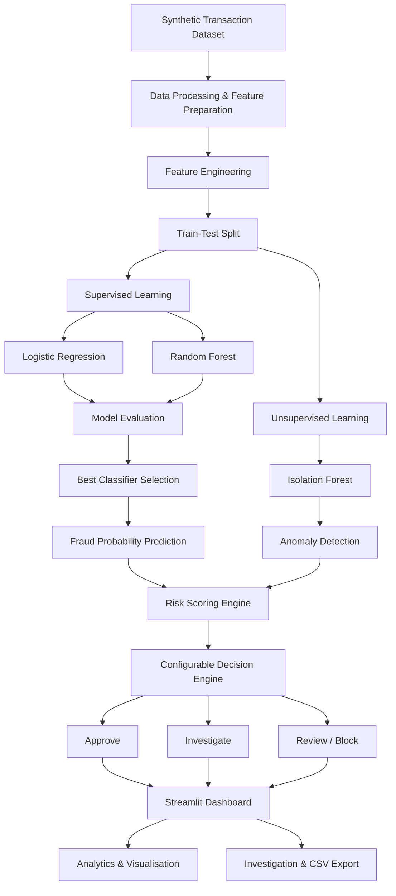

# 🛡️ FinGuard AI
### Real-Time Financial Fraud Detection & Risk Intelligence Platform

<p align="center">

**An AI-powered financial security platform combining machine learning, anomaly detection, transaction risk scoring, and interactive analytics to demonstrate intelligent financial fraud monitoring.**

</p>

<p align="center">


</p>

---

## 📌 Overview

**FinGuard AI** is an end-to-end financial fraud detection and risk intelligence application designed to demonstrate how machine learning can support transaction monitoring, suspicious activity identification, and intelligent risk assessment.

The platform integrates supervised machine learning algorithms with unsupervised anomaly detection to evaluate transaction behaviour, generate fraud probability scores, identify unusual patterns, and prioritise transactions for investigation.

Built using Python and Streamlit, the application provides an interactive financial risk command centre with transaction monitoring, model evaluation, investigation workflows, and analytical visualisations.

The project combines data engineering, predictive modelling, anomaly detection, and interactive dashboard development into a unified application.

> **Data Disclaimer:** This project uses a reproducible synthetic transaction dataset generated programmatically. It is an educational portfolio demonstration, not a production banking application. No real customer records, banking transactions, or payment integrations are used.

---

## 🎯 Project Objectives

- Develop an end-to-end machine learning pipeline for financial fraud classification.
- Implement supervised learning algorithms for transaction risk prediction.
- Apply unsupervised anomaly detection to identify unusual transaction patterns.
- Generate transaction-level fraud probabilities and configurable risk scores.
- Build an interactive Streamlit dashboard for financial risk monitoring.
- Compare machine learning models using appropriate classification metrics.
- Provide investigation workflows and downloadable analytical reports.
- Demonstrate how predictive analytics can support financial risk intelligence.

---

## 🏗️ System Architecture

FinGuard AI follows a modular architecture consisting of data generation, preprocessing, predictive modelling, anomaly detection, risk evaluation, and dashboard presentation.

### Architecture Diagram



### Architecture Components

| Layer | Component | Responsibility |
|---|---|---|
| Data Layer | Synthetic Dataset Generator | Generate reproducible transaction records |
| Processing Layer | Pandas & NumPy | Data preparation and feature handling |
| Modelling Layer | Logistic Regression | Supervised fraud classification |
| Modelling Layer | Random Forest | Ensemble-based fraud classification |
| Detection Layer | Isolation Forest | Unsupervised anomaly detection |
| Evaluation Layer | Classification Metrics | Evaluate predictive performance |
| Intelligence Layer | Risk Scoring Engine | Calculate transaction risk scores |
| Decision Layer | Threshold-Based Engine | Categorise transactions for review |
| Presentation Layer | Streamlit | Interactive dashboard |
| Visualisation Layer | Plotly | Analytical charts and visual insights |

---

## ⚙️ Key Features

### 1. Executive Risk Overview

A centralised financial risk command centre providing:

- Total transactions monitored.
- Confirmed synthetic fraud transactions.
- Transactions requiring investigation.
- Labelled fraud exposure.
- Daily transaction activity.
- Risk distribution visualisations.
- High-risk transaction summaries.

### 2. Live Transaction Monitoring

A simulated streaming environment that demonstrates transaction monitoring.

Features include:

- Sequential transaction event simulation.
- Configurable simulation speed.
- Batch-based transaction replay.
- Manual transaction risk assessment.
- Transaction-level fraud probability.
- Automated risk categorisation.

### 3. Fraud Investigation System

An investigation workspace designed to prioritise suspicious transactions.

Features include:

- Searchable transaction records.
- Risk score inspection.
- Anomaly flag identification.
- Potential risk indicator summaries.
- Downloadable investigation records.

### 4. Machine Learning Intelligence

Compare supervised classification models using:

- Accuracy
- Precision
- Recall
- F1-score
- ROC-AUC

Additional functionality:

- Model performance comparison.
- Random Forest feature importance.
- Visual model evaluation.
- Configurable fraud probability thresholds.

### 5. Interactive Data Explorer

Explore the generated transaction dataset through:

- Transaction amount filtering.
- Fraud and non-fraud filtering.
- Hour-based filtering.
- Transaction distribution analysis.
- Fraud activity visualisation.
- Downloadable filtered datasets.

---

## 🤖 Machine Learning Methodology

FinGuard AI integrates two supervised classification algorithms and one unsupervised anomaly detection algorithm.

### Supervised Learning

**1. Logistic Regression**

A statistical classification algorithm used to estimate the probability of a transaction belonging to the fraudulent class.

Purpose:
- Establish a baseline classification model.
- Estimate transaction fraud probabilities.
- Provide a benchmark for model comparison.

**2. Random Forest Classifier**

An ensemble learning algorithm that combines multiple decision trees to classify transaction patterns.

Purpose:
- Capture nonlinear relationships.
- Identify complex transaction patterns.
- Estimate fraud probabilities.
- Analyse feature importance.

### Unsupervised Learning

**3. Isolation Forest**

An anomaly detection algorithm that identifies observations exhibiting unusual characteristics compared with the overall dataset.

Purpose:
- Identify unusual transaction patterns.
- Detect potential behavioural irregularities.
- Provide an additional anomaly signal for investigation.

### Model Selection

The supervised classifiers are evaluated using ROC-AUC, and the classifier with the higher test-set ROC-AUC is selected for transaction scoring.

Isolation Forest operates independently as an additional anomaly detection component.

---

## 🧮 Transaction Risk Intelligence

The system combines supervised fraud probabilities and unsupervised anomaly signals to support transaction investigation.

### Fraud Probability

The selected classifier generates a probability:

\[
P(\text{Fraud}\mid X)
\]

### Risk Score

The predicted probability is converted into a 0–100 risk score:

\[
\text{Risk Score}=100\times P(\text{Fraud}\mid X)
\]

### Decision Engine

A configurable probability threshold determines the initial transaction classification.

| Condition | Decision |
|---|---|
| Probability above threshold | Review / Block |
| Below threshold + anomaly detected | Investigate |
| Below threshold + no anomaly | Approve |

The labels represent simulated decision-support outcomes, not actual payment authorisation or blocking.

---

## 📊 Dataset & Feature Engineering

The project generates a reproducible synthetic dataset containing **18,000 transaction records**.

Each record includes transaction characteristics, behavioural indicators, device information, and a synthetic fraud label.

### Dataset Features

| Feature | Description |
|---|---|
| `transaction_id` | Unique transaction identifier |
| `timestamp` | Transaction timestamp |
| `amount` | Transaction amount |
| `hour` | Hour of transaction |
| `day_of_week` | Day of the week |
| `distance_from_home_km` | Simulated distance from usual location |
| `transactions_last_1h` | Recent transaction velocity |
| `avg_amount_24h` | Simulated average transaction amount |
| `merchant_risk` | Synthetic merchant risk indicator |
| `device_trust` | Synthetic device trust score |
| `international` | International transaction indicator |
| `card_present` | Card-present indicator |
| `is_fraud` | Synthetic target variable |

### Data Processing Workflow

1. Synthetic transaction generation.
2. Feature preparation.
3. Stratified training and testing split.
4. Missing-value handling through model pipelines.
5. Feature scaling for Logistic Regression.
6. Supervised model training.
7. Anomaly detector training.
8. Model evaluation and comparison.
9. Transaction scoring and risk categorisation.

---

## 📈 Model Evaluation

Fraud detection is an imbalanced classification problem. Consequently, accuracy alone is insufficient for evaluating model performance.

FinGuard AI reports the following metrics:

| Metric | Purpose |
|---|---|
| Accuracy | Overall classification correctness |
| Precision | Proportion of predicted fraud cases that are fraudulent |
| Recall | Proportion of actual fraud cases detected |
| F1-score | Harmonic mean of precision and recall |
| ROC-AUC | Ability to distinguish between the two classes across probability thresholds |

The evaluation process uses a stratified train-test split to preserve the class distribution.

**Important evaluation consideration:** Synthetic labels are generated using an artificial risk mechanism. Strong performance on this dataset does not establish real-world fraud detection capability or generalisation to actual banking transactions.

---

## 🛠️ Technology Stack

| Category | Technologies |
|---|---|
| Programming Language | Python |
| Dashboard Development | Streamlit |
| Data Manipulation | Pandas |
| Numerical Computing | NumPy |
| Machine Learning | Scikit-learn |
| Visualisation | Plotly |
| Model Persistence | Joblib |
| Version Control | Git & GitHub |
| Deployment | Render |

---

## 📁 Project Structure

```text
FinGuard-AI/
│
├── app.py
│
├── setup.py
│
├── requirements.txt
│
├── README.md
│
├── DEPLOYMENT.md
│
├── render.yaml
│
├── .gitignore
│
├── LICENSE
│
├── src/
│   ├── __init__.py
│   ├── data_generator.py
│   └── modeling.py
│
├── data/
│   └── transactions.csv
│
├── models/
│   ├── fraud_classifier.joblib
│   ├── model_comparison.joblib
│   ├── anomaly_detector.joblib
│   └── model_metrics.csv
│
└── reports/
```

**Note:** The dataset and trained model files are generated locally by `setup.py`. They do not need to be committed to GitHub because the application can regenerate them when required.

---

## 🚀 Installation & Setup

### Prerequisites

- Python 3.10 or later.
- Git.
- Visual Studio Code (recommended).
- Internet connection for dependency installation.

### 1. Clone the Repository

```bash
git clone https://github.com/YOUR-USERNAME/FinGuard-AI.git

cd FinGuard-AI
```

### 2. Create a Virtual Environment

**Windows PowerShell**

```powershell
python -m venv .venv

.\.venv\Scripts\Activate.ps1
```

**macOS / Linux**

```bash
python3 -m venv .venv

source .venv/bin/activate
```

### 3. Install Dependencies

```bash
python -m pip install --upgrade pip

pip install -r requirements.txt
```

### 4. Generate Dataset & Train Models

```bash
python setup.py
```

This generates:

- `data/transactions.csv`
- `models/fraud_classifier.joblib`
- `models/model_comparison.joblib`
- `models/anomaly_detector.joblib`
- `models/model_metrics.csv`

### 5. Launch the Streamlit Application

```bash
python -m streamlit run app.py
```

Open the local application:

```text
http://localhost:8501
```

---

## 🌐 Deployment

FinGuard AI can be deployed as a publicly accessible Streamlit application using Render.

### Deployment Configuration

| Parameter | Configuration |
|---|---|
| Hosting Platform | Render |
| Runtime | Python |
| Build Command | `pip install -r requirements.txt` |
| Start Command | `python -m streamlit run app.py --server.address 0.0.0.0 --server.port $PORT` |
| Repository | GitHub |

The repository includes `render.yaml` for deployment configuration.

For detailed deployment instructions, refer to [DEPLOYMENT.md](DEPLOYMENT.md).

---

## 🔐 Responsible Use & Limitations

FinGuard AI is an educational machine learning project.

The following limitations apply:

- The dataset is entirely synthetic.
- No real financial institution or payment gateway is connected.
- Transaction approval and investigation decisions are simulated.
- Model predictions are not proof of fraudulent activity.
- No production-grade security or regulatory compliance is claimed.
- Model evaluation on synthetic data cannot establish operational performance.

A production-oriented implementation would require representative authorised financial data, temporal validation, probability calibration, fairness assessment, model drift monitoring, secure infrastructure, human investigation, and appropriate governance.

---

## 🔮 Future Enhancements

Potential extensions include:

- Real-time transaction ingestion through Apache Kafka.
- Stream processing using Apache Spark.
- Advanced anomaly detection algorithms.
- SHAP-based explainable AI.
- Model probability calibration.
- Temporal fraud behaviour analysis.
- Automated alert notifications.
- Role-based investigation workflows.
- Advanced model monitoring and drift detection.
- Secure database integration.
- Cloud-based model serving.

---

## 💼 Professional & Portfolio Highlights

**Project:** FinGuard AI — Real-Time Financial Fraud Detection & Risk Intelligence Platform

**Technical Contributions:**

- Designed an end-to-end synthetic financial transaction generation and machine learning pipeline.
- Implemented Logistic Regression, Random Forest, and Isolation Forest for fraud classification and anomaly detection.
- Developed a configurable transaction risk scoring and decision-support engine.
- Built a multi-page Streamlit dashboard with transaction monitoring, investigation workflows, model evaluation, and interactive analytics.
- Integrated model comparison, feature importance visualisation, and downloadable investigation reports.

**Core Skills Demonstrated:**

Python · Machine Learning · Predictive Analytics · Anomaly Detection · Data Engineering · Streamlit · Scikit-learn · Plotly

---

## 👨‍💻 Designed & Developed By

**Mohamed Riyaz S.**

Integrated M.Tech CSE | Business Analytics

Vellore Institute of Technology, Chennai

---

<p align="center">

**FinGuard AI — Turning Transaction Data into Intelligent Risk Insights.**

© 2026 Mohamed Riyaz S. | All Rights Reserved

</p>
